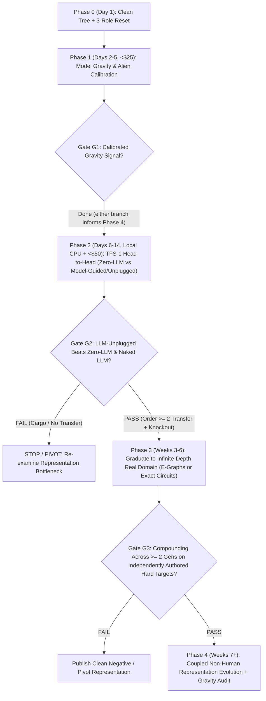

# Prometheus Strategic Reset — Strategy & Stepped Execution Plan

**Status:** PROPOSAL — UNADJUDICATED (awaiting independent adversarial review by Claude Fable 5.2 and ChatGPT Astra)  
**Date:** 2026-11-22  
**Author:** Antigravity (Gemini 4 Neon, external strategic audit)  
**Reference baseline inspected:**
- `origin/main` @ `9884ac934` (2026-11-13) & `5633cc02a` (Achilles census, 2026-11-12)
- Local checkout `F:\Prometheus` (`vivarium/v0-2026-09-05` @ `859a1bcf7`, 2026-10-03)
- Nov 12 RSI bake-off branches: `rsi-bakeoff/opus-5.5-2026-11-12` (`5f54b7b74`) & `rsi-bakeoff/fable-5.2` (`6dda8ce5a`)

---

## 1. North Star & Strategic Diagnosis

### 1.1 The North Star (Unchanged)
Per `CONSTITUTION.md` and `origin/main:CHARTER_AND_CONTINUITY.md`:

> Build a system in which **computational mechanisms and compressed representations co-evolve** ("Sagacity") so that **reusable, compounding, and potentially non-human computational organization** emerges to solve frontiers no human explicitly solved — verified by ruthless, incorruptible empirical falsification.

### 1.2 Why 25 Prior Engines Flatlined After a Few Days
Across ~5,000+ commits, 80,065 tracked files on `origin/main`, and 25 distinct engines, Prometheus established **three compounding structural walls**:

| Wall | Evidence on `origin/main` | What Stronger Late-2026 Models Change |
|---|---|---|
| **W1: Composition Wall & Stone-Discovery Gap** | 8 independent substrates failed depth-2 composition from scratch (Hestia Audit 1: Ananke FLIP `0/290`, z80atlas `0/960`, SFE `0/395`, Crius `0/475,728`, Tyche `0`, Primordial `0`, Aether `≤2/256`, Theseus `0/120`). Supplied stones succeed (`8/8` Aether S2a, `13–15/15` TFS-1, `49–50/50` Crius); autonomous stone discovery/reuse fails (`1/8` Aether S2b, `0/168` Ananke PTE-C4, `7/15` raw TFS-1 acquisition). Scaling budget (`16×` Ananke, `256²→2048²` Aether) crosses rarity, not composition. | **Nothing** if models remain banned from the organism/search loop. **Potentially decisive** if stronger models serve as semantic decomposers / sleep-phase abstractors feeding a deterministic execution runtime. |
| **W2: Toy-World Depth Ceiling** | Era 1 targeted real infinite-depth math domains (OEIS, LMFDB, Lean 4/Mathlib, Lehmer, tensor rank). Era 3 retreated to hand-authored toy worlds that rarely pay for cognition (Cosmos: 1 register optimal; Ensorain: 0 grammars need hidden state; Ludus: 2-step lookahead `≥96%` in `22/22`; Primordial: do-nothing wins; even TFS-1 foundry's Order-2 headroom is unverified per Fable 5.2). | **Nothing** unless the program graduates back to an infinite-depth, deterministically verifiable real domain instead of building World-Demand Foundries forever. |
| **W3: Fleet & Instrument Inflation** | **75 agent seats** (54 dormant, 8 parked, 6 blocked, 52 anomalies as of Nov 12); **43,512 of 80,065 files (54%)** live in `agents/` + `roles/`; Cosmos has `5.5:1` custody-to-physics code; SFE spent `95–193 s` plumbing per `0.1 s` of science; C-019 ran a 4-seat, 600-message campaign with `0` substrates selected; same-family authors/auditors created echo-chamber risk. | **Makes W3 WORSE** unless operating topology changes: stronger models generate faster charters, deeper governance rituals, and Engine #26 scaffolds with even more eloquence. |

### 1.3 Core Strategic Thesis (The Inversion)
1. **Stop using frontier models as middle-management building dumb, LLM-free toy engines.** Put stronger models **inside the sleep/abstraction/mutation loop** as semantic proposers — while enforcing a **strict "LLM-unplugged at held-out test time" contract** under the RSO Cognitive Accounting Ledger.
2. **Separate two claims that previous proposals conflated** (heeding Astra's Sept 9 critique of "linguistic disappearance of uncertainty"):
   - **Claim A (Sagacity / Crystallization):** Model-guided evolution distills experience into a compact, deterministic, **LLM-free** executable substrate `(L, T, S)` (library + rewrite theory + search policy) that transfers to independently authored held-out problems, compounds across generations, and beats both pure zero-LLM search and naked LLM prompting at matched budget.
   - **Claim B (Low-Gravity / Non-Human Mechanisms):** Tested *separately* via (i) a calibrated prior-gravity assay on late-2026 frontier models (**Phase 1**) and (ii) non-LLM selection/saturation/compression over the crystallized representation (**Phase 4**). We do *not* assume LLM-proposed libraries are alien by definition.
3. **Graduate from toy worlds to an infinite-depth, deterministically verifiable real domain** as soon as the mechanism harness is validated on `TFS-1`.

---

## 2. Asset Disposition (Hard Triage)

| Asset | Disposition | Operational Rule |
|---|---|---|
| **RSO Certification Stack** (`rso/adversary/`, `rso/completeness/`, `rso/qualify/`, Cognitive Accounting Ledger, synthetic-null gates) | **KEEP (Core Moat)** | Reuse as-is. Add **zero** new governance layers until a held-out positive exists to audit. |
| **TFS-1 + Beta-04 Foundry** (`roles/Aphrodite/beta04/tfs1/`) | **KEEP (Phase 2 Testbed)** | Pinned read-only dependency (`58` passing tests). Used strictly as a 1-week head-to-head proving ground; must not become a permanent toy-world home. |
| **Hephaestus 2.0 Gravity Pilot** (`roles/Hephaestus/HEPHAESTUS_2_0_GRAVITY_PILOT.md`) & **Hecate Alien Assay** (`hecate/alien/`) | **EXECUTE (Phase 1)** | Cheap 3–5 day calibration of late-2026 models before major engineering spend. |
| **Fable 5.2 Bake-Off M0** (`rsi-bakeoff/fable-5.2`: Theory-Guided TFS-1) | **SALVAGE AS CONTROL ARM** | Build M0 (~1,800 LOC) as the best-in-class **Zero-LLM Control Arm** in Phase 2 — *not* as a standalone bet on no-LLM RSI (which Fable 5.2 itself rates at 8–20%). |
| **Opus 5.5 Bake-Off** (`rsi-bakeoff/opus-5.5-2026-11-12`: `RLL` new DSL) | **DEFER / DO NOT BUILD** | High engineering cost (Engine #26 from scratch) + meta-level composition wall. Borrow its causal assay concepts (`θ₀` reset acceptance + meta-knockout) without building its DSL. |
| **Aether, Ananke, Crius, Tyche, Primordial, Chiasma, SFE/Proteus, Ludus, Moonshot, Odysseus, z80atlas** | **FREEZE / ARCHIVE** | Dividend already collected (proved W1–W4, trained RSO). Zero new runs permitted. |
| **75-seat fleet, Pan/Achilles census loops, multi-seat inbox ceremonies** | **KILL / QUIESCE** | Replaced by the 3-Role Operating Contract below. |

---

## 3. Non-Negotiable Operating Contract (Anti-Spin Rules)

1. **Three Roles Only:**
   - **Builder** (1 agent, 1 clean branch off `origin/main`).
   - **Cross-Family Adversary** (strictly a *different model family* than Builder — e.g., Gemini vs. Claude vs. OpenAI — running `rso/adversary/` + cognitive accounting + held-out family authoring). *No model family may grade or author held-out worlds for its own build.*
   - **Operator (Jim)** — owns phase gates, kill switches, API spend caps, and domain selection.
2. **70/30 Engineering Rule:** At least 70% of engineering time goes into domain physics, search/abstraction mechanisms, and running experiments; at most 30% into harnesses/plumbing.
3. **Cognitive Accounting Ledger (Mandatory on Every Headline Claim):** Every reported win splits computation into four explicit rows — *(1) Offline Crystallized Artifact (`L, T, S`), (2) Sleep/Evolution Proposer (LLM tokens + wall time), (3) Deterministic Search Infrastructure, (4) External Verifier* — and reports **LLM-OFF held-out performance** separately from LLM-ON performance.
4. **Strict Sequential Gating:** No phase starts until the preceding phase's frozen exit receipt is recorded and signed by the Operator.

---

## 4. Stepped Execution Plan (Phases 0–4)

---

### Phase 0 — Clean Slate & Operating Reset (Day 1 | $0 | ~2 hours)

**Objective:** Eliminate the branch drift and 75-seat background noise before writing a single line of experiment code.

**Steps:**
1. Preserve the current `F:\Prometheus` working tree (`vivarium/v0-2026-09-05`) intact (or tag it `archive/vivarium-2026-10-03`), then create ONE clean working branch/worktree off `origin/main` (`9884ac934`), e.g. `reset/prometheus-2026-11`.
2. Quiesce/disable automated census and portfolio cron loops (Achilles census / Pan auto-commits) so git history reflects only deliberate scientific commits.
3. Verify the two pinned reusable dependencies pass cleanly in the new worktree:
   - `roles/Aphrodite/beta04`: `python -m tfs1.tests.run_tests --quick`
   - `rso/adversary`: `python -m unittest discover -s rso/adversary/tests -t .`
4. Commit this strategy + the Fable 5.2 & ChatGPT Astra review synthesis as the single governing charter for the reset.

**Exit Gate (G0):** Clean worktree off `origin/main`, both baseline suites green, 0 background census commits firing.

---

### Phase 1 — Frontier-Model Calibration: Hephaestus 2.0 Gravity Pilot + Hecate Completion (Days 2–5 | <$25 API | Local CPU)

**Objective:** Before building a multi-week system around late-2026 frontier models, empirically measure two things you paused Prometheus to wait for:
1. **Can late-2026 models generate causally explicit, knockout-testable mechanisms that resist compression onto known human priors?** (Executed per `roles/Hephaestus/HEPHAESTUS_2_0_GRAVITY_PILOT.md`.)
2. **How do multiple model families behave on unfamiliar lawful ("alien") systems?** (Complete the unfinished Gemini and third-family arms of `hecate/alien/`, fixing the thinking-budget output truncation documented in `hecate/alien/REPORT_pilot.md`.)

**Exact Protocol:**
1. **Calibration First (Hard Pre-Gate):** Run the 12 hand-authored calibration controls (disguised PID, TCP congestion control, Kalman filter, Hebbian learning, reaction-diffusion, stigmergy, autocatalysis + composites + incoherent nonsense) through **at least two distinct model families** acting as blind Gravity Detectors.
   - *Abort rule:* If a detector fails to recover `≥75%` of disguised familiar mechanisms (high gravity) while rejecting incoherent nonsense, the Gravity Detector is **UNVALIDATED** — fix the detector prompt/rubric before touching Nous triplets.
2. **Stratified Historical Sample (50–64 triplets, frozen seed):** Regenerate causal-knockout mechanism hypotheses using two distinct frontier families (crossed design: Family A generates → Family B detects priors on blind representation; Family B generates → Family A detects priors).
3. **Hecate Completion:** Re-run `hecate/alien/` on Gemini (with raised output token budget + top-level JSON key validation) and one OpenAI/Astra-family model on the frozen 100-system set (`hecate/alien/data/public.json`), comparing structured tuple vs. prose ablation across all three families.

**Exit Gate (G1 — Informative Under Both Branches):**
- **Branch G1-A (Low-Gravity Survivors Found):** `≥5%` of specimens show high mechanistic specificity, genuine 3-way causal knockout sensitivity, AND low prior fit under a calibrated cross-family detector → promotes a **calibrated alien-hypothesis nominator** into Phase 3/4.
- **Branch G1-B (High-Gravity Collapse):** `≥95%` collapse onto disguised familiar machinery even on late-2026 models → establishes empirically that **LLM generation alone cannot escape human ontology**; therefore alienness in Phase 4 *must* come from non-LLM selection/saturation/compression, and LLMs are scoped strictly as semantic search accelerators in Phases 2–3.

---

### Phase 2 — Head-to-Head Mechanism Proof on `TFS-1`: Zero-LLM vs. Model-Guided (LLM-Unplugged at Eval) (Days 6–14 | Local CPU + <$50 API)

**Objective:** Resolve the core architectural bet in **one shared, pinned, zero-new-substrate harness** (`roles/Aphrodite/beta04/tfs1/` + `rso/`): does Model-Guided Wake-Sleep Distillation beat both (a) Fable 5.2's best-in-class Zero-LLM Rewrite-Theory Learner and (b) naked frontier-model prompting — **when the LLM is completely unplugged at held-out test time**?

**Experimental Design (Four Frozen Arms, Identical Evaluator & Work Meter):**
Build a compact new package (`sagacity_pilot/`, ≤2,500 LOC, zero edits to frozen `tfs1/` or `rso/`):

| Arm | Sleep / Evolution Phase | Held-Out Test Phase | Purpose |
|---|---|---|---|
| **Arm 0: `BASE-OE`** | None | Frozen `TFS-1` + OE pruning | Existing Beta-04 baseline |
| **Arm 1: `ZERO-LLM-M0`** | Fable 5.2 M0 rewrite-law miner (`probe_oe` collisions → verified refinement laws + normal-form enumeration + refactoring-normalized compression) | Offline `(L, T)` on `TFS-1`, **LLM OFF** | Strongest pure no-LLM baseline from the Nov 12 bake-off |
| **Arm 2: `MG-UNPLUGGED`** | Frontier model inspects dev failures/traces/KillVectors and proposes typed `TFS-1` library primitives + rewrite laws + priority weights, each **verified deterministically by `TFS-1` kernel before admission** | Offline `(L, T, w)` on `TFS-1`, **LLM COMPLETELY OFF** | Primary Prometheus test: crystallized Sagacity |
| **Arm 3: `SHADOW-NAKED`** | None (zero inheritance) | Same total LLM API dollar/token budget spent directly on held-out tasks | Dossier 83 shadow / anti-amortization control |
| **Arm 4: `KNOCKOUT / SHAM`** | Arm 2 artifact with (a) promoted primitives ablated, or (b) laws scrambled | Offline on `TFS-1`, **LLM OFF** | Causal necessity & anti-cargo control |

**Mandatory Anti-Goodhart & Anti-Cargo Rules (Frozen Pre-Run):**
1. **Cross-Family Held-Out Split:** The Cross-Family Adversary authors **30 fresh held-out task families** (including genuine Order-2 compositions requiring ≥2 interacting stepping stones, with **no supplied decomposition** and **readout fallback OFF**). Neither Builder nor Arm 2's proposer ever sees held-out families during evolution.
2. **Exact Cost Accounting:** Every arm reports total TFS-1 interpreter units (`U`), wall time, and API spend in the 4-row Cognitive Accounting Ledger.
3. **RSO Adversarial Kit Registration:** Register the Phase-2 reducer as a target in `rso/adversary/` (must pass DROP, DUPLICATE, REWRITE_DERIVED, CONSTANT, SCRUB_ANSWER with `0 SURVIVED`, `0 VACUOUS`).

**Frozen Exit Gate (G2 — Decide Whether to Graduate to Real Domains):**
- **PASS (`GO TO PHASE 3`):** On the independently authored held-out families (readout fallback OFF, LLM OFF at eval):
  1. `MG-UNPLUGGED` (or `ZERO-LLM-M0`) solves **≥2× more held-out Order-2 families** (or achieves **≥5× lower median hitting cost** on solved families) than `BASE-OE`, **AND**
  2. `MG-UNPLUGGED` outperforms `SHADOW-NAKED` per dollar/evaluation amortized across the held-out suite (proving crystallization pays over fresh prompting), **AND**
  3. `KNOCKOUT` drops performance by **≥50% of the gain** (proving causal reliance on inherited `(L, T)` rather than search/scoring artifacts), **AND**
  4. Cross-Family Adversary Q3 review finds zero unresolved leakage or cargo defects.
- **PARTIAL (`ZERO-LLM WINS`):** If `ZERO-LLM-M0` matches or beats `MG-UNPLUGGED` → drop the LLM proposer and scale Fable 5.2's M0/M1 pure theory-guided route into Phase 3!
- **KILL (`STOP & DIAGNOSE`):** If neither `ZERO-LLM-M0` nor `MG-UNPLUGGED` clears `BASE-OE` on independently authored Order-2 families without fallback → **hard stop**. Do *not* move to Phase 3; diagnose whether the bottleneck is (a) TFS-1 expressivity, (b) abstraction credit assignment, or (c) lack of continuous/sub-symbolic guidance.

---

### Phase 3 — Graduate to ONE Infinite-Depth Real Domain (Weeks 3–6 | Only if G2 Passes)

**Objective:** Escape Wall W2 (toy-world depth ceiling) permanently by porting the winning Phase-2 distillation loop to **one real domain where infinite compositional depth and an incorruptible deterministic verifier already exist**.

**Domain Candidates (Operator selects ONE at G2 closeout based on Phase 1 & Phase 2 evidence):**

| Candidate | Deterministic Verifier | Why Infinite Depth / Sagacity Fits | Setup Friction |
|---|---|---|---|
| **Track 3A (Recommended Default): Equational / E-Graph Symbolic & Algebraic Discovery** (e.g., `egg` / e-graph rewrite libraries over symbolic algebra, polynomial/recurrence identities, OEIS sequences, or LMFDB invariants) | Exact symbolic/algebraic equivalence + bounded high-precision counterexample battery (`sympy` / `mpmath` / `egg`) | Direct structural generalization of Phase 2's `(L, T)` rewrite-theory loop; zero toy-world authoring; connects directly back to Era-1 math catalogs. | **Low** (days) |
| **Track 3B (Best for "Alien Circuits"): Exact Algorithmic / Circuit Kernel Synthesis** (e.g., exact minimum-gate Boolean/arithmetic circuits, sorting networks, small bilinear/tensor schemes, or SAT/CSP heuristics) | Bit-exact truth-table / algebraic tensor verifier + exact gate/operation count | Proven domain where **genuinely non-human structures exist** (e.g., AlphaTensor-class decompositions); immune to toy-world ceilings; naturally supports non-LLM evolutionary search in Phase 4. | **Low–Medium** (~1 week) |
| **Track 3C (Defer Unless 3A/3B Succeed): Lean 4 / Mathlib Lemma & Tactic Crystallization** | Lean 4 kernel type-checker | Highest external scientific prestige; already partially explored in `charon` & `nyx`. | **High** (toolchain & state-latency tax; risk of plumbing drag) |

**Phase-3 Core Experiment (Order-2 → Order-3 Compounding Test):**
- Run **3 sequential generations** (`G1 → G2 → G3`) over progressively harder slices of the real domain (strictly held-out problem splits per generation).
- **The Decisive Test (Compounding Sagacity):**
  1. Does a **frozen, LLM-unplugged Generation-3 substrate** solve problems in the held-out hard slice that Generation-1's substrate could not?
  2. **The Weaker-Model Transfer Test:** Does a **small/cheap local model (or pure symbolic solver)** equipped with Generation-3's crystallized `(L, T, S)` beat a **naked frontier model** on the held-out hard slice at matched cost?

**Exit Gate (G3):** Demonstrated ≥2-generation compounding on independently held-out real-domain targets, verified with LLM unplugged + knockout + Cognitive Accounting Ledger + Cross-Family Adversary sign-off.

---

### Phase 4 — Coupled Non-Human Representation Evolution ("True Sagacity") (Weeks 7+ | Only if G3 Passes)

**Objective:** Push beyond "human-readable libraries distilled from frontier LLMs" toward **genuinely non-human representations and mechanisms**.

Only unlocked once Phase 3 proves compounding crystallization works in a real domain:
1. **Split-Representation Mutation** (the one new idea endorsed by Aporia on Sept 9): pair **continuous receptor/routing drift** (or learned latent/e-graph equivalence classes) with **type-safe discrete operator mutation**, selected strictly on **downstream held-out transfer + MDL compression**, *never* human readability.
2. **Gravity Audit of Emergent Artifacts:** Feed evolved, knockout-verified Phase-4 mechanisms (stripped of names) back into **Phase 1's calibrated Gravity Detector** and run **RSO counterfactual lesioning** to measure whether evolution discovered genuinely low-gravity (non-human-prior) mechanisms.
3. **Shadow-Run Open-Endedness Control (Dossier 83):** Require evolutionary activity to exceed a preregistered heredity-removed shadow run before claiming coupled co-evolution.

---

## 5. Known Weaknesses of This Plan (Surfaced Deliberately for Reviewers to Attack)

To avoid writing marketing copy, here are the five sharpest vulnerabilities we explicitly invite Fable 5.2 and ChatGPT Astra to attack:

1. **The "Compiled Human Priors" Trap:** If Phase 2 & 3 use a frontier LLM to propose abstractions/rewrite laws, even an impressive LLM-unplugged win might just be *caching human textbook math/algorithms into a fast DSL* — useful engineering, not non-human reasoning. Is Phase 1 + Phase 4 enough to separate genuine Sagacity from textbook compilation, or does this strategy punt the core Prometheus thesis?
2. **Phase-2 `TFS-1` Ceiling Risk:** Is spending 8–9 days on `TFS-1` (a small integer-list DSL whose Order-2 depth is still unverified) smart de-risking, OR is it one more week spent on a toy world when we should jump straight to Track 3A (e-graphs) or Track 3B (exact circuits)?
3. **Comparing Unmatched Computation Channels (`MG-UNPLUGGED` vs. `SHADOW-NAKED`):** How should LLM API spend during sleep-phase evolution be fairly amortized against direct LLM prompting on held-out tasks so the comparison cannot be gamed by cherry-picking held-out suite size `N`?
4. **Gravity Detector Validity in Phase 1:** Can an LLM-based Gravity Detector really distinguish "genuinely novel mechanism" from "under-specified or convoluted mechanism" even with 12 disguised-prior controls? What is the sharpest falsifier for Phase 1 itself?
5. **Hidden Cost of Cross-Family Held-Out Authoring:** Requiring a second model family to author 30 fresh Order-2 held-out families in Phase 2 introduces its own potential defect class (triviality, unsolvability, or motif collapse — the exact Beta-04 foundry pain). How do we qualify those 30 families cheaply without rebuilding a 5.5:1 World-Demand Foundry?

---

## 6. Budget & Timeline Summary

| Phase | Calendar Window | Compute / API Cap | Deliverable | Hard Kill / Pivot Rule |
|---|---|---|---|---|
| **Phase 0** | Day 1 | Local, `$0` | Clean branch off `origin/main`, 3-role reset, green baseline tests | Must complete cleanly before any experiment runs |
| **Phase 1** | Days 2–5 | Local CPU + `≤$25` API | Calibrated cross-family Gravity Pilot report + complete Hecate multi-family report | If calibration controls `<75%`, detector is UNVALIDATED |
| **Phase 2** | Days 6–14 | Local CPU (`≤40` core-h) + `≤$50` API | Head-to-head `TFS-1` receipt (`BASE-OE` vs `ZERO-LLM-M0` vs `MG-UNPLUGGED` vs `SHADOW-NAKED` vs `KNOCKOUT`) | Must beat `BASE-OE` & `SHADOW-NAKED` with LLM OFF + knockout ≥50% or STOP |
| **Phase 3** | Weeks 3–6 | Local CPU/GPU + `≤$150` API | 3-generation compounding receipt on Track 3A or 3B | Must show G3 > G1 compounding on independently held-out targets or STOP |
| **Phase 4** | Weeks 7+ | Scoped after G3 | Split-representation evolution + calibrated Gravity Audit + Dossier-83 shadow run | Gated entirely behind G3 |
